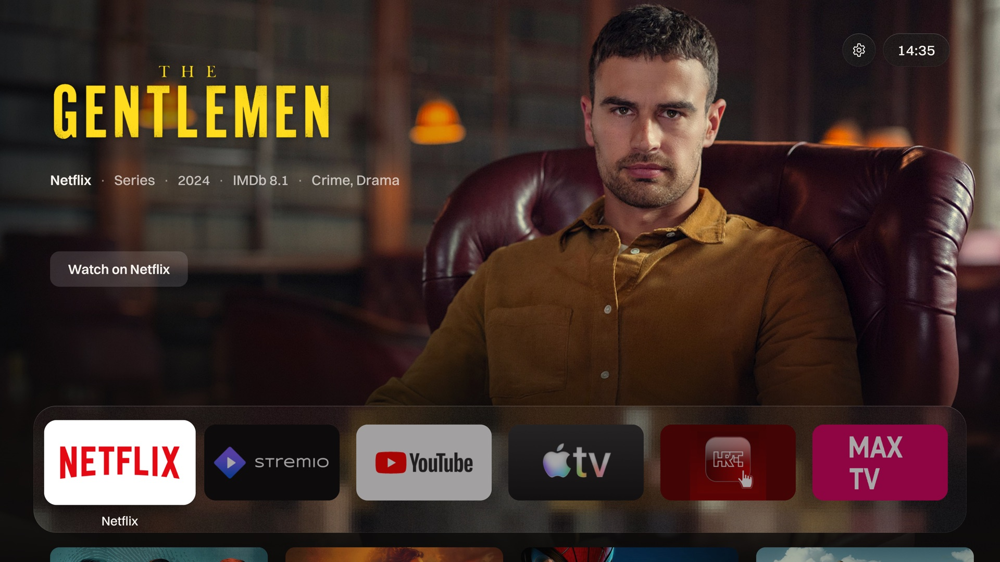
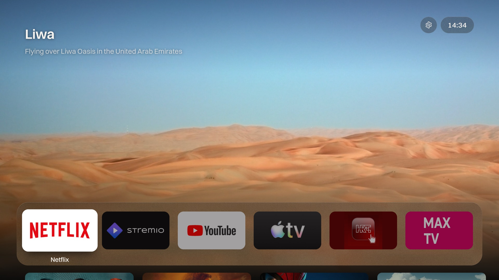
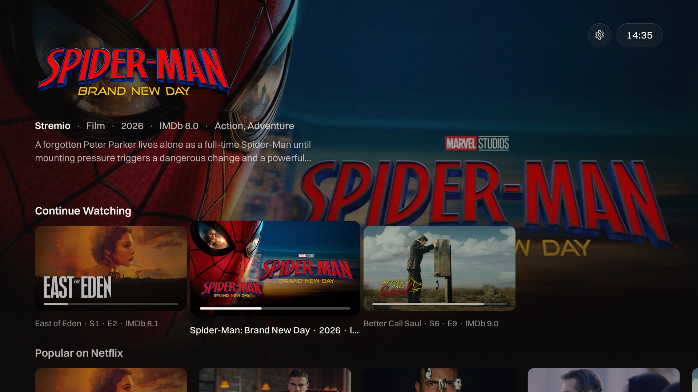
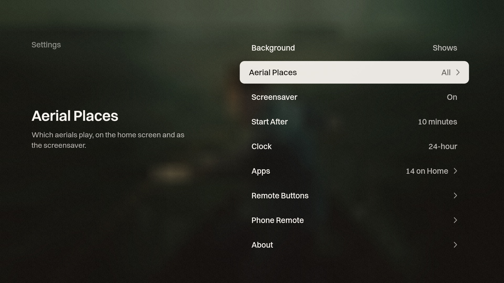
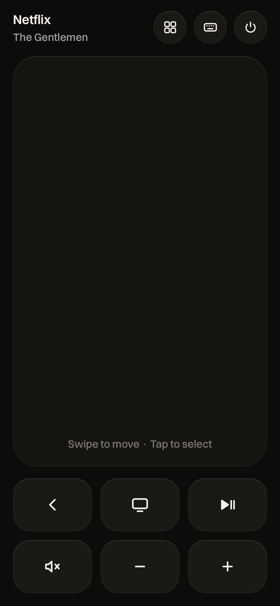

# HomeTV

An Apple TV-style home screen for Android TV and Google TV, with a phone remote that runs in the
browser. It is built on [couch-tv](https://github.com/Seagey/couch-tv) by Seagey and runs entirely
on the TV: no computer has to stay on.



## What it looks like

**Apple aerials behind the home screen.** Pick Aerials as the background and the home screen plays
Apple's aerial films, with the place named in the corner. The same films play as the screensaver.



**Shows to pick up.** Move down from the apps to browse Continue Watching, Popular on Netflix and
trending series and films. The artwork behind follows what is focused, and Select opens it in the
app it streams on.



**Settings on the TV.** Background, aerial places, screensaver, clock, live sport and live TV,
hidden genres, which apps sit on the home row, and what the remote's extra buttons open.



**The phone remote.** Open the TV's address on your phone and add it to the home screen. Swipe on
the pad to move, tap to select, with back, home, play and volume underneath. The top shows what is
playing, and the buttons there open apps, type into the TV and switch it off.



## Features

- **Home row of apps** with real app banners. Hide the ones you never open in Settings.
- **Backgrounds:** artwork from popular shows, or Apple's aerial films (Landscapes, Cities, Space,
  Underwater).
- **Screensaver** with the aerials, after 5 to 30 minutes.
- **Live sport and live TV** at the top of the home screen, from the TvProfil guide, with artwork
  from TMDB where it has some. Sport follows the words you choose (out of the box: F1 and
  NK Osijek).
- **Remote buttons:** the Philips and Rakuten TV keys on the TV's own remote open any app you
  pick.
- **Phone remote** paired with a 6 digit code shown on the TV.

## Build

You need the JDK and Android SDK in `build/` (see [docs/couch-tv-README.md](docs/couch-tv-README.md)
for the original build notes), plus a free [TMDB](https://www.themoviedb.org/settings/api) API key.

1. Put the key in `.env.local` at the repo root. The file is git-ignored.
   ```
   TMDB_KEY=your-key-here
   ```
2. Build the APK. The first run downloads the Switzer font from Fontshare.
   ```
   sh scripts/build-next.sh
   ```
   The APK lands in `dist/couch-tv-next.apk`.
3. Install it on the TV over ADB, then open **Couch TV** on the TV for the remote's address and
   pairing code:
   ```
   adb connect <tv-ip>:5555
   adb install -r dist/couch-tv-next.apk
   ```
4. To use it as the home screen, follow
   [Use it as the home screen](on-tv/README.md#use-it-as-the-home-screen-optional).

**Sport photos (optional).** Put `f1.jpg` and `osijek.jpg` in `home-next/sport/` to show a photo
behind those events. Without them the event shows on a plain dark card.

**Preview on a computer.** `python3 home-next/serve.py 4630` serves the home screen with sample
data at `http://localhost:4630`, and `?bg=aerial` switches to the aerials.

## Turning the TV on from an iPhone

Once the TV sleeps, the app on it sleeps too, so it cannot wake itself. A Wake-on-LAN packet from
the phone can, if the TV keeps its network on in standby. On Philips TVs that is the "Switch on
with Wi-Fi (WoWLAN)" setting under the network settings.

1. Install a Wake-on-LAN app with Shortcuts support, such as Wake Me Up, and add the TV by its MAC
   address.
2. In Shortcuts, make a shortcut that runs the app's wake action for the TV, then opens the remote's
   address.
3. Add it to the home screen or ask Siri to run it.

## Privacy

Nothing personal is in this repository: no API keys, addresses or photos. Keys go in `.env.local`,
which git ignores. Before publishing changes, run:

```
sh scripts/privacy-scan.sh <your-denylist-file>
```

## Credits

- [couch-tv](https://github.com/Seagey/couch-tv) by Seagey, MIT licence. The original README is in
  [docs/couch-tv-README.md](docs/couch-tv-README.md).
- Aerial films by Apple, streamed from Apple's servers and not included here.
- Show data from Stremio Cinemeta and JustWatch, artwork from TMDB. This product uses the TMDB API
  but is not endorsed or certified by TMDB.
- [Switzer](https://www.fontshare.com/fonts/switzer) by Indian Type Foundry, downloaded at build
  time.
